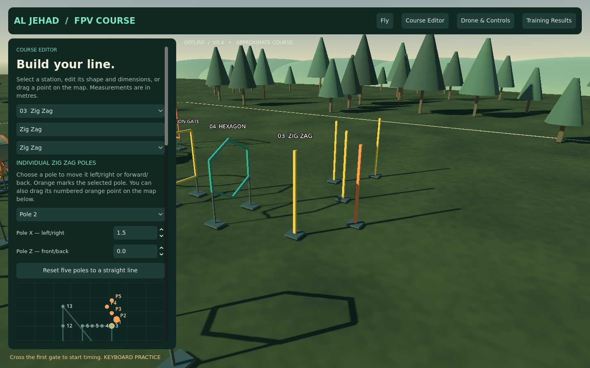
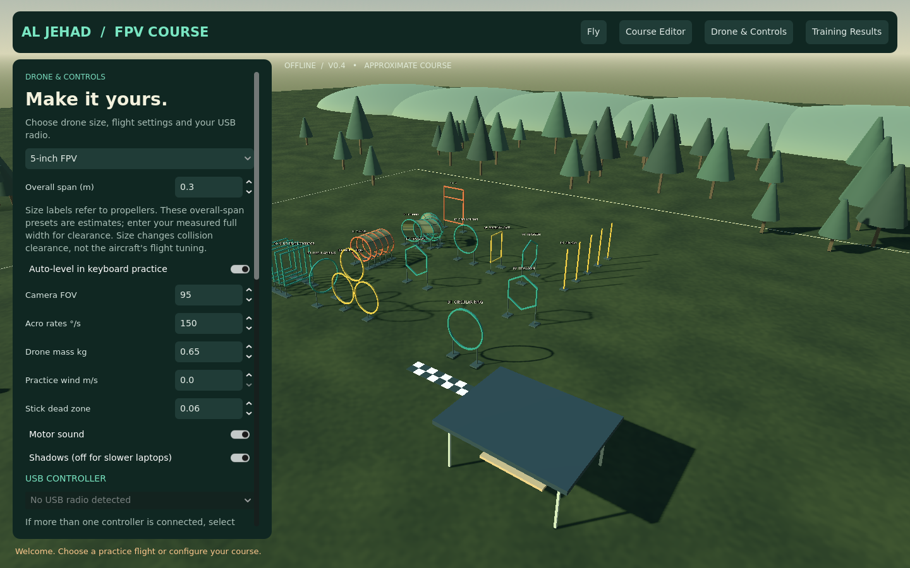
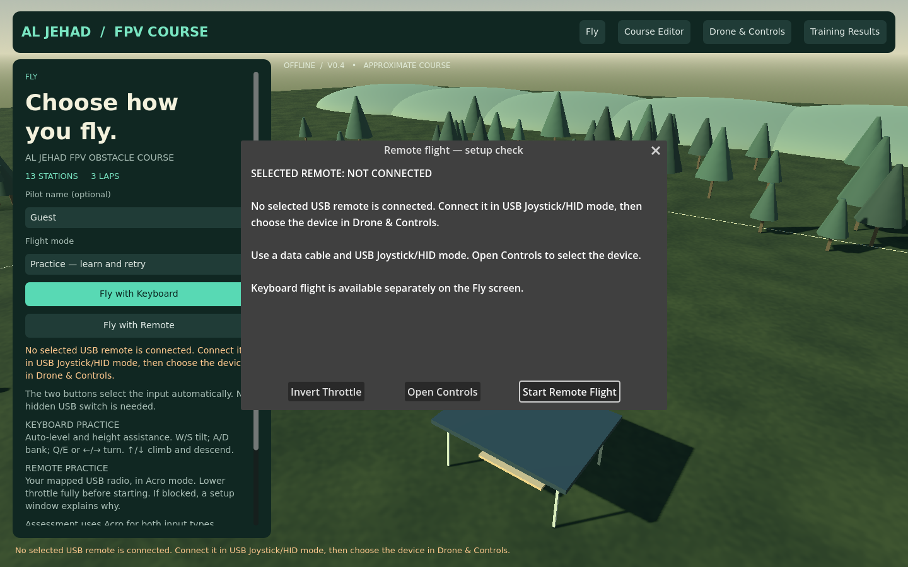

# AL JEHAD FPV OBSTACLE COURSE — v0.4

**[Download Windows ZIP — about 36 MB](https://github.com/Usama2896/my.portfolio/raw/refs/heads/fpv-simulator-prototype/simulator/FPVTrainer-Windows-Prototype.zip)**

## Open this version

1. Extract the ZIP into a new folder.
2. Open **AL-JEHAD-FPV** and run **AlJehadFPV.exe**. Keep the supporting files together.
3. Watch the two-second **AL JEHAD** opening screen; the menu should say **V0.4**.
4. Choose Practice or Acro Assessment, then **Fly with Keyboard** or **Fly with Remote**.

Pilot name is an optional text field, not a launch option. No VS Code, Godot, Steam, account or Internet connection is required to run the export.

## Remote-start correction

Previously, enabling USB made both launch buttons follow the same remote checks, even the button labelled keyboard practice. The separate USB-enable switch is now removed. The two new buttons explicitly choose their input source.

If a remote cannot start, a setup window shows the reason and live throttle readings. It provides **Open Controls**, **Invert Throttle** and **Start Remote Flight**. Low throttle is still required. Throttle calibration now detects direction when confirmed with the stick fully down. Unfinished calibration can be cancelled without changing confirmed mappings.

**[Beginner remote guide: REMOTE-SETUP.txt](REMOTE-SETUP.txt)** is also inside the ZIP and available in Drone & Controls. Your earlier calibration, courses and records remain in the existing DTC Flight Lab data folder.

## Added customization

- **Individual poles:** select Zig Zag, then Pole 1–5. Change Pole X/Z or drag its orange P1–P5 map point. The chosen pole turns orange and its passage target follows it.
- **Drone sizes:** 2.5, 5, 7, 10, 13 and 16–17 inches. These have approximate overall spans; enter a measured span for clearance. Size changes the collision envelope and gate passage checks, not the flight model.
- **Station transforms:** X/Z position, Y height, and yaw/pitch/roll through a full 360°. Shapes stay unchanged while moving or rotating.
- **Whole-course rotation:** turn the layout around station 1 while preserving gaps and shapes.
- Existing 17 obstacle types, station spacing, course import/export, local records and CSV export remain available.

Click **Save course locally** after course edits. Drone and controller settings save automatically. Export a custom course before restoring the supplied layout.

## Actual application screenshots

[Flight](screenshots/flight.png) · [Hexagon](screenshots/hexagon.png) · [Triple ring](screenshots/triple.png) · [Tunnel](screenshots/tunnel.png) · [Triangle](screenshots/triangle.png) · [Diamond](screenshots/diamond.png) · [Dive ring](screenshots/dive.png)

## Verification and practical limits

**313 automated checks passed:** 114 general checks, 96 obstacle/spacing checks, 24 yaw checks, 6 keyboard-flight checks, 35 remote-launch/calibration/splash checks, and 38 new customization/size checks. Remote tests inject deterministic USB reports into the same production input path and verify actual throttle-driven lift. Actual button signals, high-throttle blockers, unfinished calibration, inversion, device selection and disconnect behavior are covered. Small-versus-large drone clearance was checked using both gate progression and physical collisions.

Rendered views were inspected. Windows export and packed-resource startup were checked in Linux. The user confirmed radio detection/calibration on an earlier Windows version; the revised v0.4 remote launch still needs a physical TX16/Pocket retest. Flight dynamics, course dimensions and crash classification remain approximate. This is a development release, not yet a calibrated commercial simulator.

The Windows executable is unsigned. If Windows shows a warning, report the exact wording rather than disabling protection.

[Full development guide and limitations](source/fpv-trainer/README.md) · [Source project](source/fpv-trainer)
