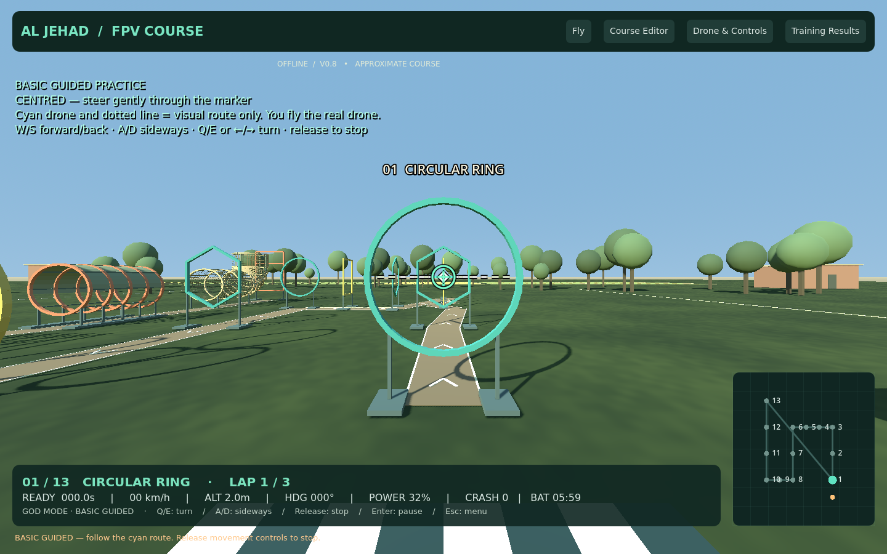
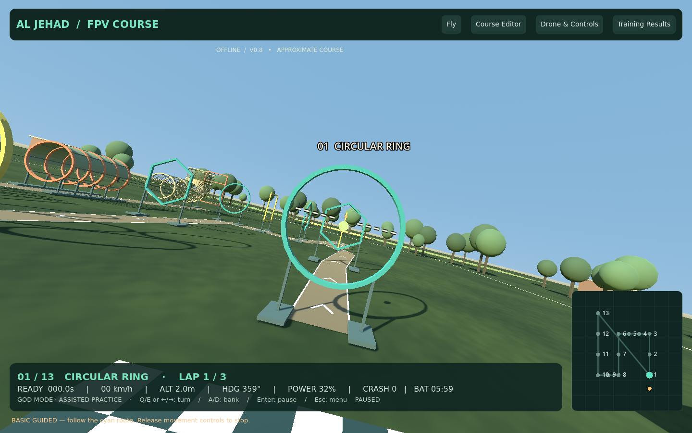
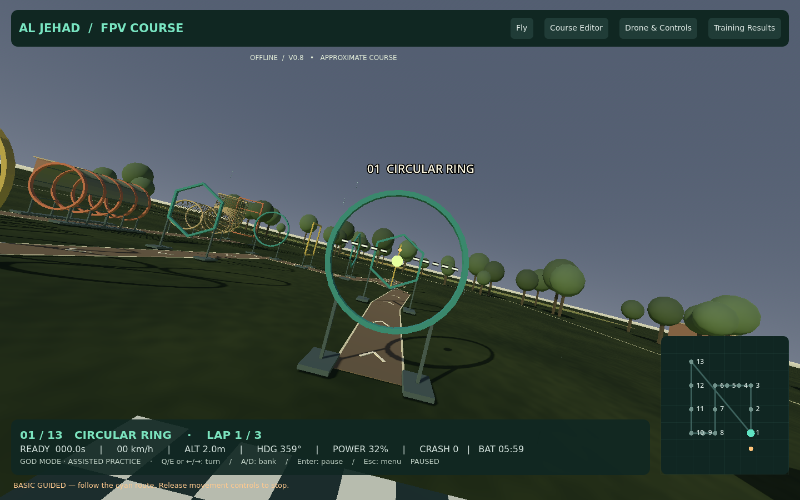

# AL JEHAD FPV OBSTACLE COURSE — v0.8.1

[Download Windows ZIP](https://github.com/Usama2896/my.portfolio/raw/refs/heads/fpv-simulator-prototype/simulator/FPVTrainer-Windows-Prototype.zip)

Close the old app, extract the ZIP into a new folder, then open **AL-JEHAD-FPV/AlJehadFPV.exe**. Check **V0.8.1**. No Godot, VS Code, installer or Internet is required to run it. Existing calibration, saved courses and records are retained.

## Calibration memory — v0.8.1

The same radio automatically restores its saved axis mapping, travel limits, centres and inversions. It reuses the last profile even when its USB device index or instance GUID changes, provided the radio name identifies one connected device. Exact device profiles take priority. Older matching profiles are imported without deleting calibration. With several identical radios, select the intended device and verify its live values; USB cannot reliably distinguish identical names without stable identifiers.

Open Controls only when you want to change calibration. Map an axis and confirm as before; cancelling unfinished mapping keeps the saved settings. Calibration belongs to the Windows account on that PC, not to the ZIP or USB stick. A different PC/account needs initial calibration. Low-throttle arming is still required each flight; this is not recalibration.

Nine new checks cover a fresh app instance, endpoints, centres, inversions, reconnect, repeated GUID/index changes and cancellation. Remote launch and customization regressions also pass.

## What changed

- Punjab-inspired flat farmland, crop plots, irrigation channel, broadleaf trees, farm buildings and warmer daylight. Lightweight procedural scenery, not photorealistic assets.
- A continuous ground track with edge lines and direction arrows through the ordered stations. It rebuilds with course edits and can be disabled. The track shows horizontal route; use the airborne guide for climb/vertical tunnel sections.
- **Normal, Hot, Cold, Windy and Storm** weather presets. Custom wind 0–8 m/s, direction, gust strength and scene brightness. Storm has darker lighting and light rain. Hot/cold are visual presets, not battery-temperature or thermal simulations. Easy cancels wind for learning; assessment keeps calm competition conditions.
- A **six-minute battery** by default, adjustable from 0.5–30 minutes or disabled. Counts active motor-enabled flying from launch, even before the first gate. Pause and remote arming do not drain it. Warning beeps in the last 30 seconds; at zero, motors and flight assistance cut, the drone falls, and the flight ends on landing or after eight seconds. God Mode does not bypass battery. R starts a fresh flight and battery; checkpoint recovery does not recharge it. This is a time-limit model, not a voltage/current simulation.
- Difficulty selector ordered **Easy — Basic Guided**, **Medium — Beginner Stabilized**, **Hard — Acro Practice**, then **Acro Assessment**. Hard selects Acro for keyboard and radio. Experts can still customize keyboard assistance in controls.
- Optional **moving attitude reference in every level**. Press **V** to show/hide. It banks and moves with pitch relative to the fixed aiming reference. At level flight it returns to centre. This is separate from the fixed white diamond and the Basic opening target.
- Motor, impact, launch, gate-clear, finish and low-battery sound effects in all difficulty levels. One Sound effects switch controls them.
- Optional contact vibration requests for supported USB gamepads. Most RadioMaster USB joystick modes do not expose rumble; software cannot add that hardware capability.
- Goggles fullscreen output option and external-display selector. Windows Duplicate output is the simplest setup. This is a single FPV image, not stereo VR, device pairing or wireless video transmission.

## First flight

1. Open **Fly** and choose **Easy — Basic Guided**. Leave God Mode on for initial practice.
2. Click **Fly with Keyboard**. W/S forward/back; A/D sideways; Q/E or Left/Right turns; Up/Down changes height. Release movement keys to stop.
3. Follow the ground arrows and cyan airborne guide. Align the centre diamond with the coloured opening target. The guide is visual, not autopilot.
4. **V** toggles the moving attitude line. Enter pauses, R restarts with a fresh battery, Esc opens menu, F11 toggles fullscreen.
5. For a radio, use **Fly with Remote**, lower throttle fully to arm, then raise above halfway to climb. Near halfway holds height in Easy/Medium; fully low cuts motors. Use your calibrated mapping.
6. Open **Drone & Controls**, scroll to **Environment & Flight Options**, and adjust weather, wind, battery, ground route, attitude, rumble and goggles options.

[Remote guide](REMOTE-SETUP.txt) · [Goggles connection guide](GOGGLES-SETUP.txt)

Cobra model inputs must be checked in its manual. AV-only goggles generally require a powered **active HDMI-to-composite converter** and the correct AV cable. USB may only provide power/firmware. No physical Cobra output or controller vibration has been verified in the cloud.

## Retained features

Faster adjustable yaw; upward-exit photo-based U-tunnel; real collision feedback and checkpoint recovery; God Mode; 17 obstacle shapes; individual zigzag pole positions; drone sizes; XYZ/rotation/spacing editor; JSON import/export; visibility/FOV controls; local sessions/CSV; USB mapping, calibration and diagnostics. Records remain in the existing DTC Flight Lab user-data directory.

## Validation

471 checks passed: 463 Godot checks plus seven offline radio-page checks and one native mouse launch check. These include 20 new environment, battery, route, difficulty and attitude checks plus 443 existing checks. The new tests verify battery cutoff in God Mode, pause, recharge, wind direction, setting persistence, collision-free ground route, mode order and the attitude line's bank/pitch direction. Rendered route, tilt and storm screens were inspected. Windows export is checked separately; a physical Windows/Cobra/TX16 test remains necessary.

[Development guide](source/fpv-trainer/README.md)
