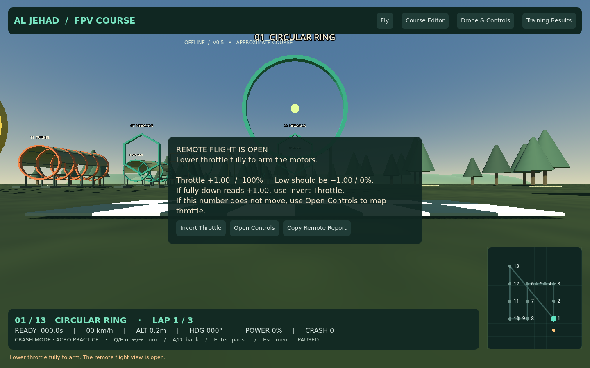
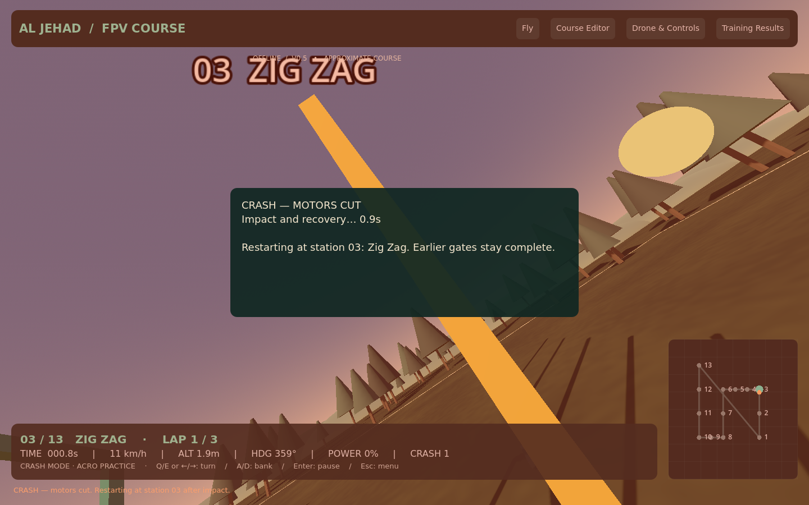
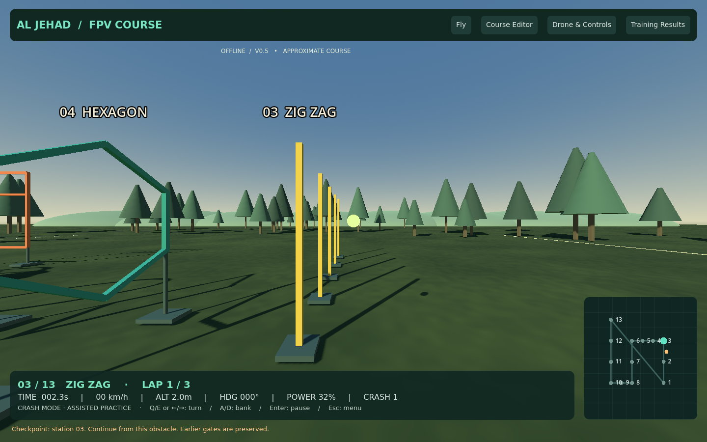

# AL JEHAD FPV OBSTACLE COURSE — v0.5

**[Download Windows ZIP — about 36 MB](https://github.com/Usama2896/my.portfolio/raw/refs/heads/fpv-simulator-prototype/simulator/FPVTrainer-Windows-Prototype.zip)**

Extract into a new folder. Open **AL-JEHAD-FPV/AlJehadFPV.exe** and check **V0.5**. No VS Code, engine installation or Internet is required.

## Remote launch: view first, motors second

Choose **Fly with Remote**. A configured radio now opens the actual flight view even if throttle is high. Motors remain off and the body stays frozen until throttle stays near **−1.00 / 0% for 0.2 seconds**. Then **REMOTE ARMED** appears; raise throttle gently. The drone starts near ground level rather than dropping from an airborne spawn.

High throttle no longer leaves you retrying a menu Start button. Missing devices, unfinished calibration and duplicate channels still have explicit setup messages. The popup Start handler is deferred outside its window event. It was checked with an actual X11 mouse click on the rendered button, in addition to simulated USB reports.

The user's TX16 input readings of −1 down/+1 up sound correct. Those readings alone do not establish the cause of the previous Windows launch failure. This revised flow needs a physical retest. **Copy Report** in the popup or **Copy remote diagnostic report** in Controls supplies useful launch/axis details if it still fails.

## Two practice collision modes

- **Crash Mode:** hard impacts cut motors, allow physical rebound and tumble, and add brief camera shake, flash and impact sound. After roughly 1.1 seconds, restart near the current obstacle. Earlier gates and lap progress stay complete. Remote recovery requires low throttle to re-arm.
- **God Mode:** physical bumps remain, but there is no crash penalty, motor cut or automatic reset. It is invulnerability, not flying through solid objects.

Light touches give feedback without a hard-crash penalty. Assessment always enforces its existing first-crash deduction and second-crash disqualification; God Mode cannot bypass scoring rules.

## Test your radio locally alongside the game

Double-click **RADIO-TEST.html** inside the ZIP, then **Activate controller test**. The offline page shows connected controllers, raw axis bars, observed ranges and buttons. **Copy report** lets you paste the readings into chat. No data is uploaded automatically. It also opens from Controls > Open offline browser Radio Test.

This reads USB input on the PC where you open it. Plugging a radio into your laptop does not make it available to the assistant's cloud workspace. Some browsers restrict the Gamepad API on local files; the in-app diagnostic report is the fallback. Browser axis order can differ from Godot.

**[Beginner guide](REMOTE-SETUP.txt)** · [Radio Test source](RADIO-TEST.html)

## Retained features

17 obstacle types; individual five-pole Zig Zag editing; XYZ and yaw/pitch/roll transforms; station gaps, course scaling/rotation and JSON import/export; 2.5, 5, 7, 10, 13 and 16–17-inch size categories; local pilot records and CSV export; assisted keyboard practice and Acro assessment. Existing data stays in the DTC Flight Lab user-data folder.

## Actual rendered views

[Opening screen](screenshots/splash.png) · [Pole editor](screenshots/poles.png) · [Controls](screenshots/controls.png)

## Verification

331 Godot checks passed: 114 general, 96 obstacle/spacing, 6 keyboard flight, 24 yaw, 29 remote launch/arming/calibration, 38 customization/size and 24 physical impact/recovery checks. Seven browser-page checks passed with simulated Gamepad data. One rendered native mouse-click check verified the actual popup Start button. This is **339 checks total**, plus export/resource startup checks.

Physics checks exercise actual obstacle collisions, rebound, motor cut, tumble, checkpoint progress, God Mode and assessment enforcement, including a yawed collision. Remote checks use injected USB reports through the production adapter; they do not replace testing the physical TX16 on Windows. The browser page also needs a real-controller test locally. Windows export and packed resources are validated in Linux; Windows frame rate and exact drone realism are not established.

This remains a development simulator with approximate flight physics, impact thresholds and course measurements. The executable is unsigned; report Windows warnings without disabling protection.

[Full development guide](source/fpv-trainer/README.md)
