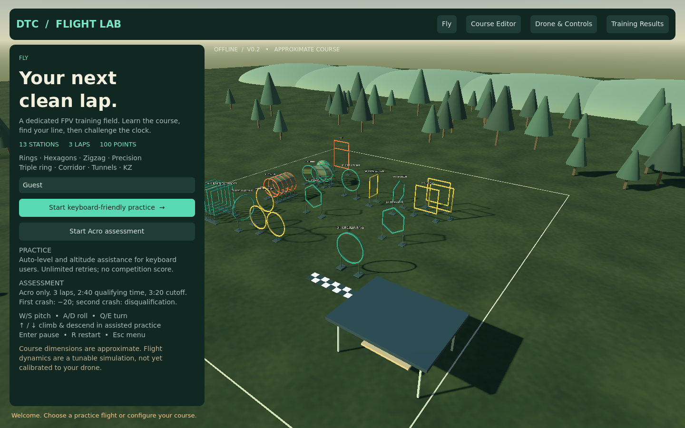
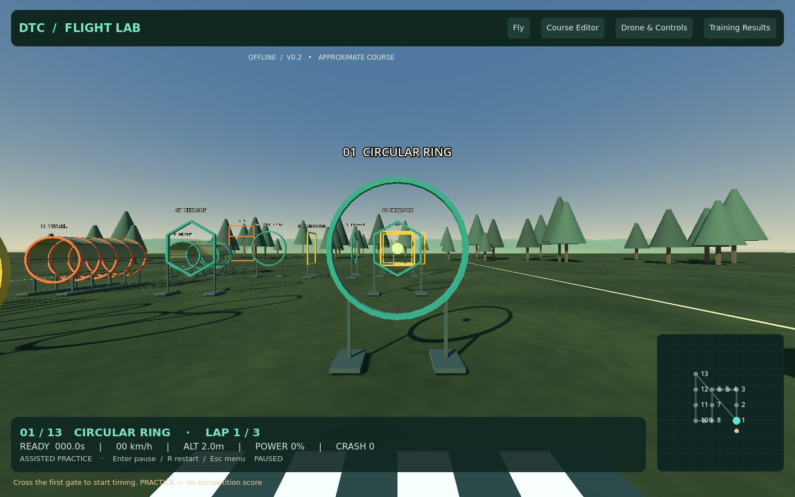
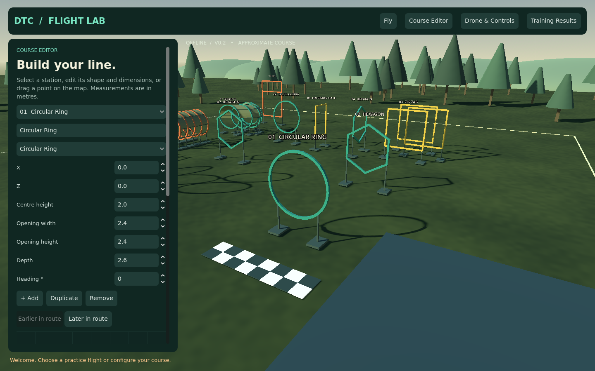
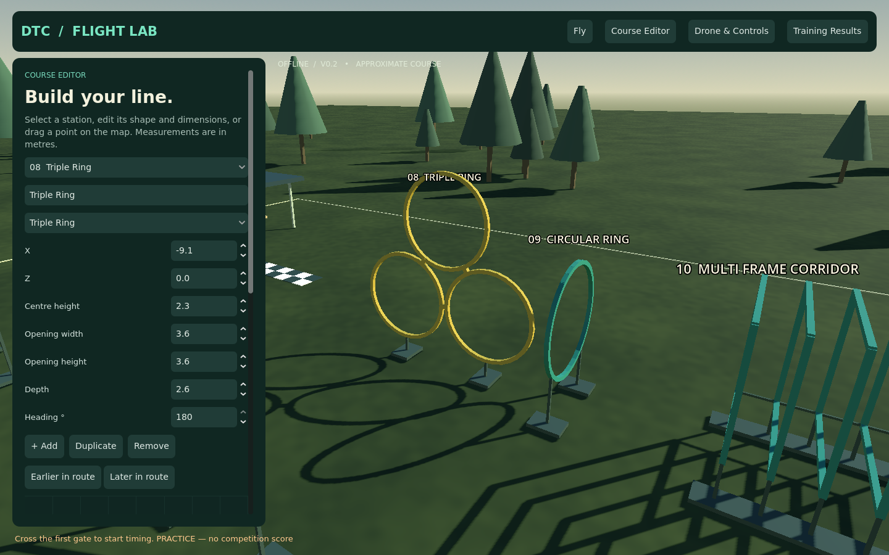
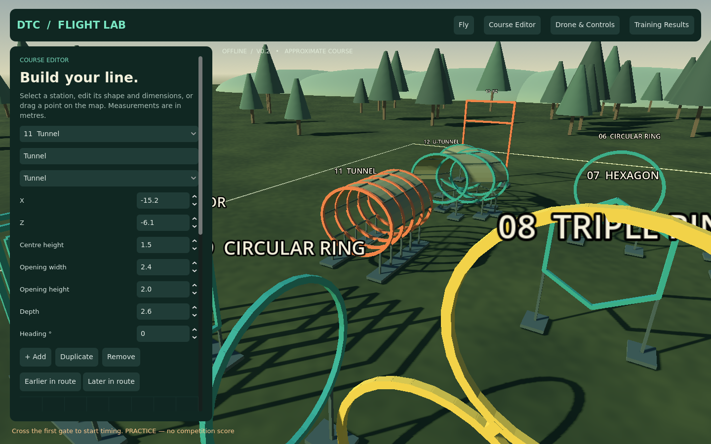

# DTC Flight Lab — offline FPV simulator v0.2

## Download for Windows

**[Download Windows ZIP (about 36 MB)](https://github.com/Usama2896/my.portfolio/raw/refs/heads/fpv-simulator-prototype/simulator/FPVTrainer-Windows-Prototype.zip)**

1. Download the ZIP above. No VS Code or controller is required.
2. In Downloads, right-click the ZIP → **Extract All** → **Extract**.
3. Open **FPVTrainer**, then run **FPVTrainer.exe**. Keep all files together.
4. Click **Start keyboard-friendly practice**. The drone automatically holds height.
5. Hold **↑** to climb; release to hold height. **↓** descends. Tap **W/S** to tilt forward/back, **A/D** roll, **Q/E** turn.
6. **Enter** pauses, **R** restarts, **Esc** returns to the menu.

If Windows shows a security warning, do not disable protection; report the exact wording. This development build is unsigned and has not been run on Windows yet.

## What's new

- Nine different obstacle shapes across 13 stations, including rings, hexagons, zigzag, precision gate, triple ring, corridor, tunnel, U-tunnel and KZ.
- Assisted keyboard practice and separate Acro assessments.
- Course editor with dimensions, add/remove/duplicate/reorder, draggable map, local save and JSON import/export.
- Drone/control settings, USB axis calibration/inversion/dead zone, and a shadow toggle for slower laptops.
- Pilot names, local training history, scoring and CSV results export.
- New menus, field, sky, vegetation, lighting, shadows, flight HUD, minimap and motor sound.

## Actual screenshots

These are rendered from the application, not concept images.

More views: [hexagon](screenshots/hexagon.png), [zigzag](screenshots/zigzag.png), [corridor](screenshots/corridor.png), [U-tunnel](screenshots/u-tunnel.png), [KZ](screenshots/kz.png), [controls](screenshots/controls.png), [results](screenshots/results.png).

## Tested versus pending

98 automated checks passed in Linux: 92 scene/shape/course/settings/rules/axis checks and 6 physical keyboard-flight checks. Actual rendered views were inspected. Windows export and packed-resource startup were checked. Physical Windows operation, laptop frame rate and RadioMaster remotes still need testing.

This is a much more capable development release, not yet a finished Liftoff replacement. Layout/dimensions and some obstacle interpretations remain approximate. Physics, wind and crash classification are preliminary; bonus timing defaults to disabled pending the missing rule. See the [full guide and limitations](source/fpv-trainer/README.md).

Source project: [source/fpv-trainer](source/fpv-trainer). Your original portfolio files are unchanged.
