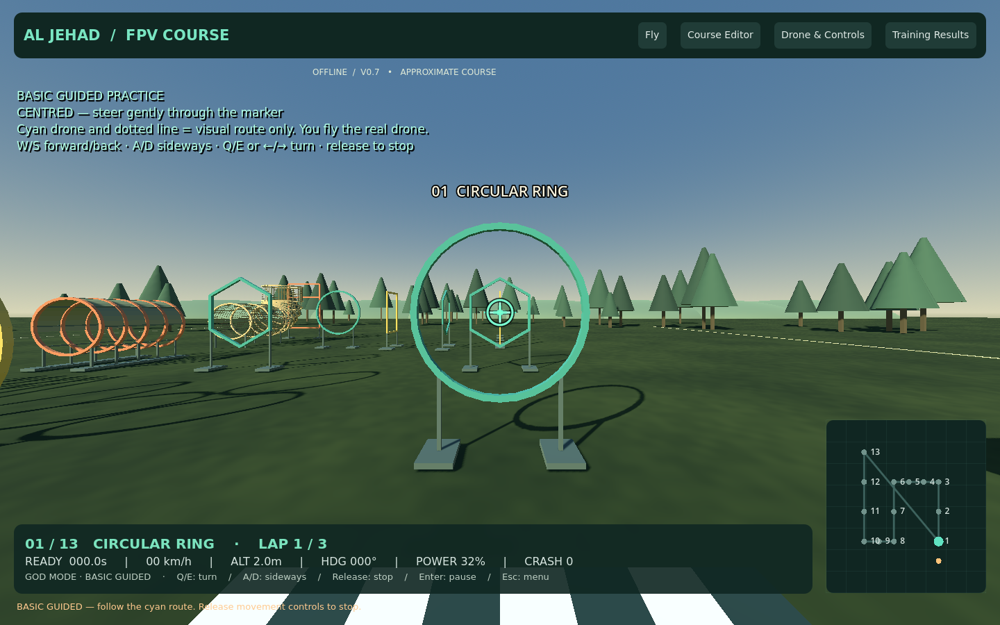
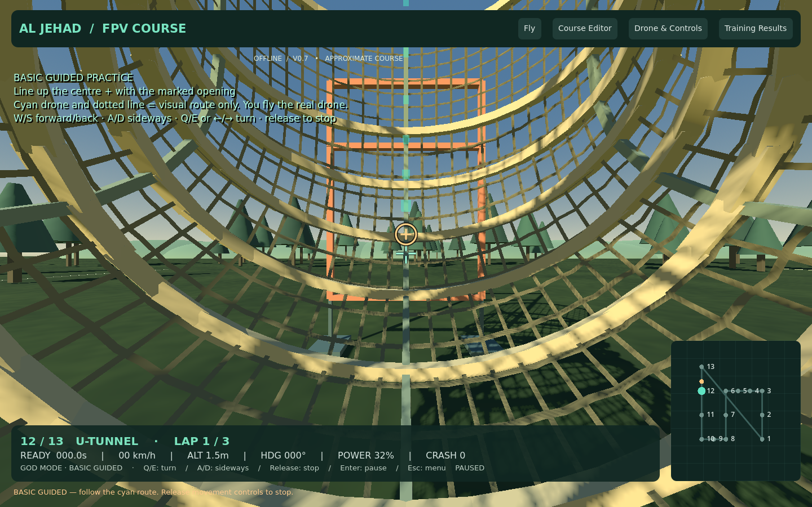

# AL JEHAD FPV OBSTACLE COURSE — v0.7

**[Download Windows ZIP — about 36 MB](https://github.com/Usama2896/my.portfolio/raw/refs/heads/fpv-simulator-prototype/simulator/FPVTrainer-Windows-Prototype.zip)**

Close the old app, extract into a new folder, and open **AL-JEHAD-FPV/AlJehadFPV.exe**. Check **V0.7**. Saved calibration, courses and records remain available. No Internet or engine installation is needed to run the export.

## Faster, independent yaw

Practice yaw now has its own **Yaw speed °/s** setting in Drone & Controls, default **180°/s**, adjustable from 45 to 540. This fixes the previous stabilized-mode turning limit of roughly 69°/s. Pitch/roll sensitivity stays separate. Basic uses 80% of the configured yaw speed; Acro Assessment retains its original Acro rate.

The setting changes real turning response: a 1.5-second stabilized full-stick test measured approximately 311° at the 240 setting versus 118° at 90, including damping and initial smoothing. Physical radio tuning still needs the user's feedback.

## New Basic Guided Practice — easiest

Choose **Basic Guided Practice — easiest** in Flight mode, then Fly with Keyboard or Fly with Remote. It is the third practice level alongside ordinary Practice and Beginner Stabilized; assessment remains separate.

- Slow forward/sideways movement with a level horizon.
- Release movement keys or centre pitch/roll sticks to brake and stop.
- Altitude assistance, gentle steering and calm conditions.
- God Mode is selected initially; Crash Mode remains available.
- A centre **+**, marked opening reticle, off-screen direction arrows and green **GATE CLEAR** feedback.
- A moving cyan guide drone and dotted route through the current obstacle, including the upward tunnel.

The cyan drone is a visual guide, not autopilot. It cannot collide with you or complete gates for you. The guide fades near the camera to avoid blocking the view. Wrong-side approaches point back to the entry, and openings too small for the selected drone show a warning.

## First flight in simple steps

1. Choose **Basic Guided Practice** and leave **God Mode** selected.
2. **Keyboard:** Fly with Keyboard starts a hover. W/S moves forward/back; A/D moves sideways; Q/E or Left/Right arrows turn. Up/Down climbs/descends. Release movement keys to stop.
3. **Remote:** Fly with Remote opens disarmed; lower throttle to arm. Raise it above halfway to climb, then near halfway to hold height. Right stick moves forward/back/sideways; left stick horizontal turns (usual Mode 2 mapping). Fully low throttle still cuts motors.
4. Follow the cyan route. Align the centre + with the outlined opening marker. Turn or climb/descend when the guide arrow says so.
5. Enter pauses, R restarts, Esc opens the menu, F11 toggles full screen.

**[Full beginner/remote guide](REMOTE-SETUP.txt)** is included in the ZIP. Ordinary remote Practice stays Acro and does not use Basic movement assistance; assessment has no guide or Basic assists.

## Retained features

Photo-based upward-exit U-tunnel, visibility/FOV controls, working remote launch/arming, Crash Mode/God Mode and checkpoint recovery, individual pole positions, drone sizes, 17 obstacle types, XYZ/rotation/spacing editing, local records and CSV export. RADIO-TEST.html remains available for offline local USB diagnostics.

## Verification

451 checks passed: 443 Godot checks (129 general, 101 obstacle/spacing, 6 keyboard flight, 24 yaw, 29 remote launch, 38 customization/size, 24 crash/recovery, 47 upward tunnel, 17 stability/visibility and 28 Basic/yaw/guidance), seven radio-page JavaScript checks and one native rendered popup mouse-click check. Rendered aiming and guide views were inspected. Windows export and packed-resource startup were checked in Linux.

New tests cover actual yaw-speed response, keyboard and injected-radio Basic movement, stopping/height hold, correct clockwise radio yaw, ghost route through the upward exit, wrong-side guidance, clearance warnings and assessment isolation. A visual guide never advances pilot progress. This does not replace a physical Windows/radio retest of the new mode.

Basic is a deliberately assisted learning mode, not a calibrated real-aircraft model. Geometry, collision envelopes and dynamics remain approximate. The executable is unsigned; report Windows warnings without disabling protection.

[Full development guide](source/fpv-trainer/README.md)
