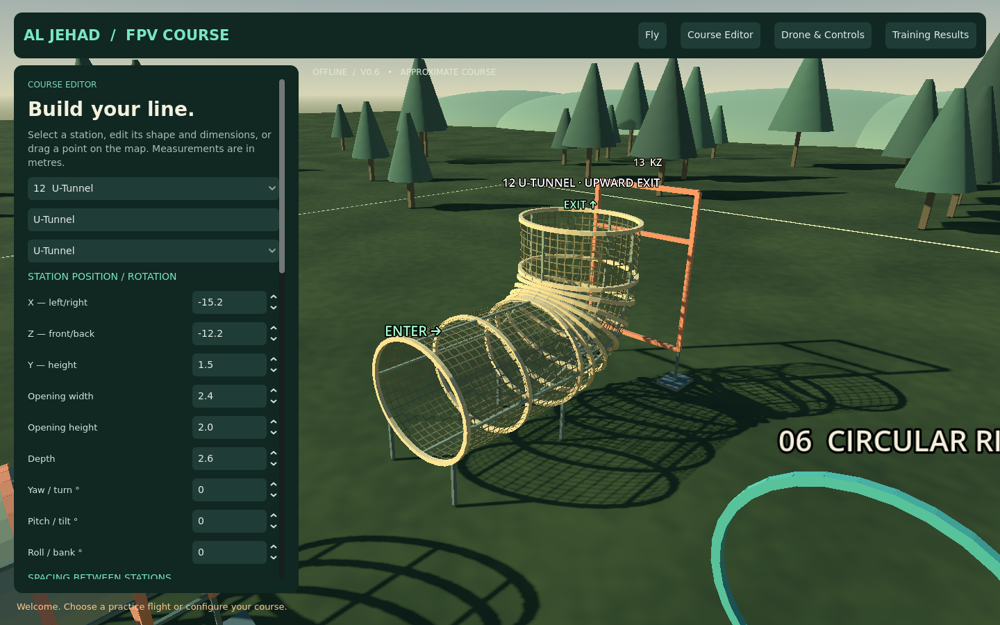
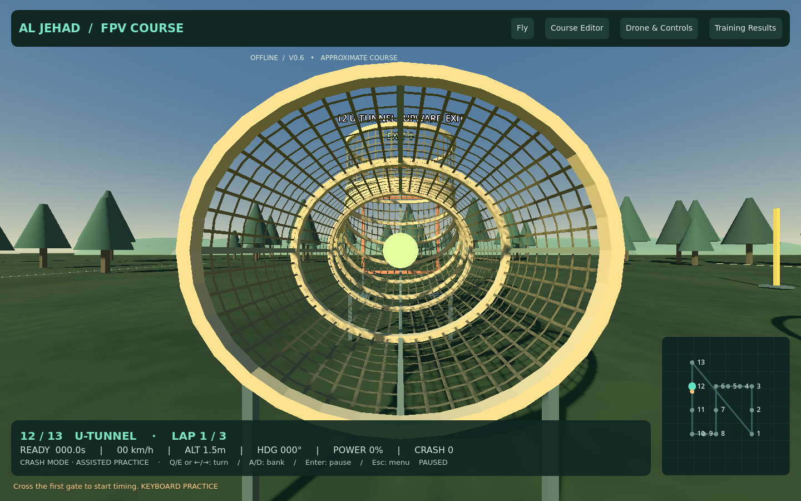
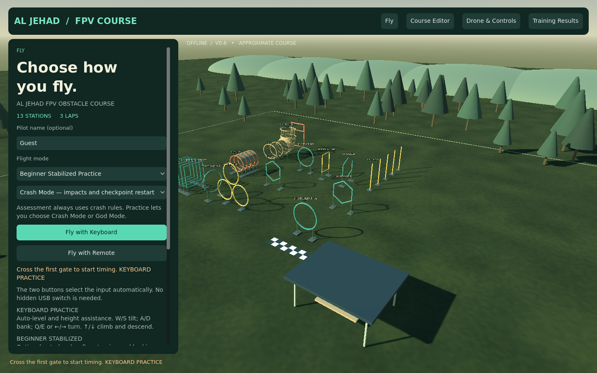
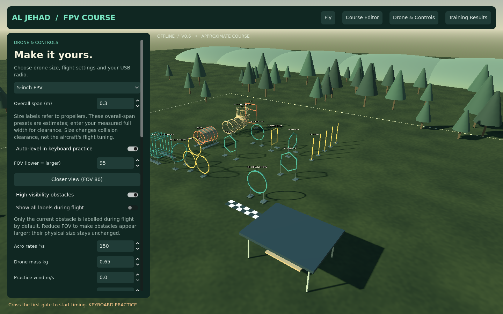

# AL JEHAD FPV OBSTACLE COURSE — v0.6

**[Download Windows ZIP — about 36 MB](https://github.com/Usama2896/my.portfolio/raw/refs/heads/fpv-simulator-prototype/simulator/FPVTrainer-Windows-Prototype.zip)**

Close the older app, extract into a new folder, and run **AL-JEHAD-FPV/AlJehadFPV.exe**. Check **V0.6**. Existing calibration, courses and records remain in the same user-data folder.

## Photo-based upward U-tunnel

The old horizontal curved tube is replaced with a net-covered tunnel matching the supplied photo's route: **enter horizontally → travel through the tube → turn upward → exit through the open top**.

The entrance and upward exit are both open; the net walls have collision. Ten oriented checkpoints follow the straight section, curved elbow and vertical neck. Flying straight through or descending through the top cannot complete the obstacle. Existing saved U-tunnel stations use the replacement automatically; no course reset is needed. Dimensions remain approximate and can be adjusted with the existing editor controls.

## Visibility controls

High-visibility obstacles is ON by default, with brighter frame contrast and slightly stronger ambient lighting. Flight labels show only the current obstacle by default and hide when too close to the camera. Editor overview labels remain available.

In **Drone & Controls**, use **Closer view (FOV 80)** if obstacles appear too small or distant. You can also adjust FOV manually, switch high visibility off, or show all flight labels. These affect the view rather than obstacle dimensions or collision rules.

## Optional Beginner Stabilized Practice

On Fly, choose **Beginner Stabilized Practice** from Flight mode, then Fly with Keyboard or Fly with Remote.

It adds softer steering, auto-level, limited tilt and gentle braking when sticks are centred. Remote throttle near halfway holds height; above halfway climbs, below halfway descends, and fully down still cuts motors. Raise it above halfway to lift off, then centre it to hold height. Low-throttle arming still applies.

Ordinary remote Practice keeps Acro behavior, and Acro Assessment always stays Acro. This is an approximate learning aid, not a calibrated real-flight autopilot.

## Retained workflow

The working remote launch/arming flow, Crash Mode/God Mode and checkpoint recovery, 17 obstacle choices, individual pole editing, drone-size categories, course transforms/spacing, local results and CSV export remain available. The offline **RADIO-TEST.html** and **[beginner guide](REMOTE-SETUP.txt)** are included in the ZIP. No Internet, VS Code or engine installation is required to run the export.

## Verification

423 checks passed: 415 Godot checks (129 general, 101 obstacle/spacing, 6 keyboard flight, 24 yaw, 29 remote launch/arming, 38 customization/size, 24 impact/recovery, 47 upward-tunnel, 17 stability/visibility), seven local radio-page checks and one rendered native popup mouse-click check.

Tunnel checks include ordered horizontal-to-upward passage, reverse/straight-exit rejection, transformed stations, physical side walls, open inlet/outlet and unobstructed centre path. Stability checks include remote climb/height hold, auto-level, drift braking, low-throttle motor cut and Acro assessment isolation. Rendered tunnel and entry views were inspected; Windows export/resource startup was checked in Linux.

The user confirmed the previous version's remote/crash workflow was working. The new geometry and optional beginner mode need practical feedback on that PC. Dimensions, dynamics and assistance remain approximations. The executable is unsigned; report Windows warnings without disabling protection.

[Full development guide](source/fpv-trainer/README.md)
